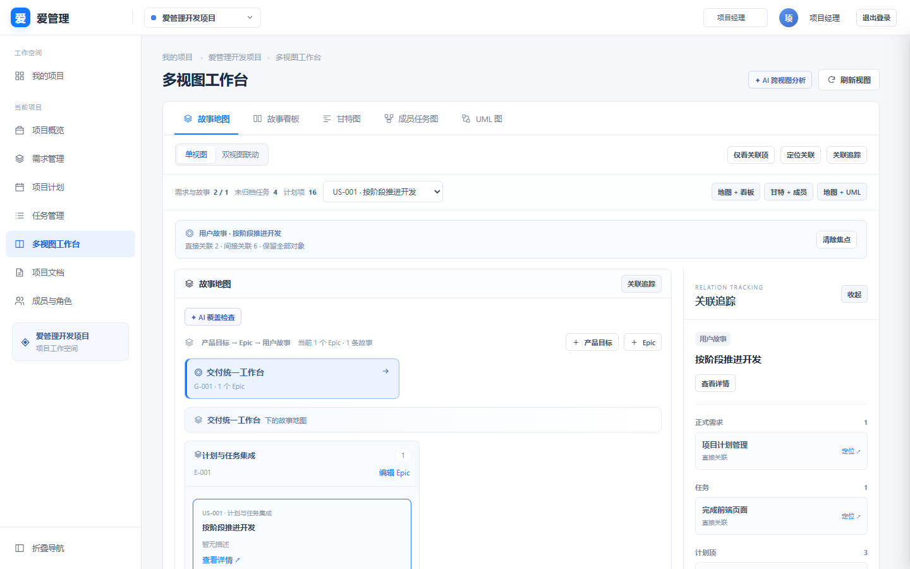
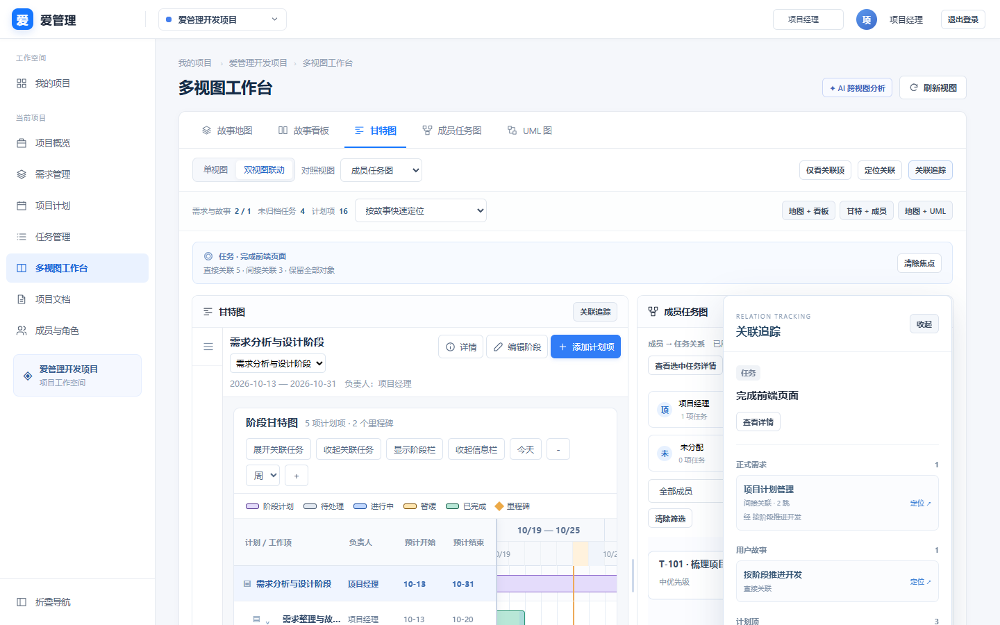
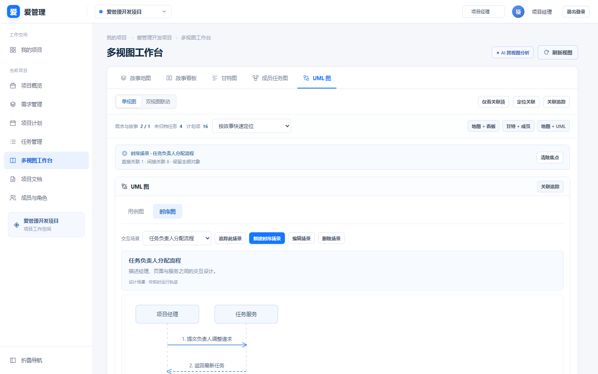
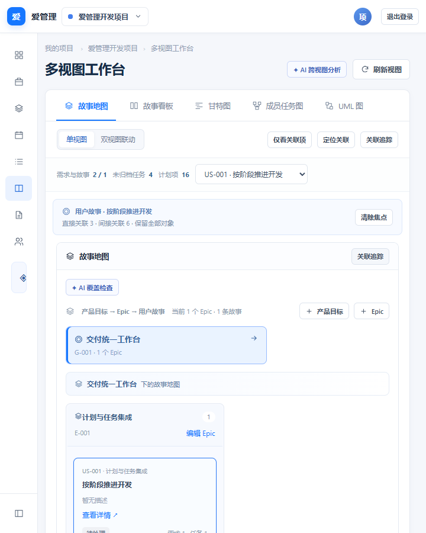

# V2.0 选择性融合验收证据

2026-10-24，基线 `4a9b894`，交付分支 `feat/workbench-v2-fusion`。截图为真实 React/NestJS/PostgreSQL 应用，数据来自隔离验收夹具。

## 自动化检查

| 检查 | 结果 | 日志 |
| --- | --- | --- |
| 前端 Vitest | 37/37 通过（含新增工作台 6 项） | [web-tests.txt](web-tests.txt) |
| 后端 Jest/真实 PostgreSQL | 133/133 通过，12 套件 | [api-tests.txt](api-tests.txt) |
| 生产构建 | 通过，保留已有大包告警 | [build.txt](build.txt) |
| A 侧 + D1–D4/UML 浏览器 | 16 组通过，运行异常 0 | [a-browser-result.json](a-browser-result.json) |
| B 侧浏览器 | 12 组通过，运行异常 0 | [b-browser-result.json](b-browser-result.json) |
| AI/P3 浏览器 | 11 组通过，运行异常 0，付费模型请求 0 | [ai-browser-result.json](ai-browser-result.json) |

新增迁移测试先部署旧版本，填充项目、成员、需求、故事、任务、计划、用例和文档，再执行新增迁移并重复部署，逐行/逐列比较原数据，最后检查 Prisma 模型无结构漂移。

浏览器回归保留原甘特图拖动/两端调整/日期持久化/粒度切换、任务和需求编辑、用例节点与边编辑、成员/文档管理、跨会话同步和权限撤销等断言。按本次确认的交互，将工作台的自动弹详情改为显式详情入口。

复现：先按仓库说明准备本地 PostgreSQL 和私有 `.env`，执行 `pnpm db:generate` 与 `pnpm build`，然后：

```powershell
pnpm --filter @spm/web test --maxWorkers=1
pnpm --filter @spm/api test
$env:SPM_CHROME_PATH='C:/Program Files/Google/Chrome/Application/chrome.exe'
node scripts/owner-a-browser.cjs
node scripts/s2-v43-browser.cjs
node scripts/ai-p3-browser.cjs
```

测试使用随机 schema，自动清理；浏览器测试不得同时运行使用相同端口的同一脚本。AI 回归使用显式本地协议夹具，不调用真实付费模型。

## 页面截图

### 单视图关联追踪



### 原甘特图与成员图双栏对照、覆盖追踪



### 新增时序场景



### 窄屏布局


